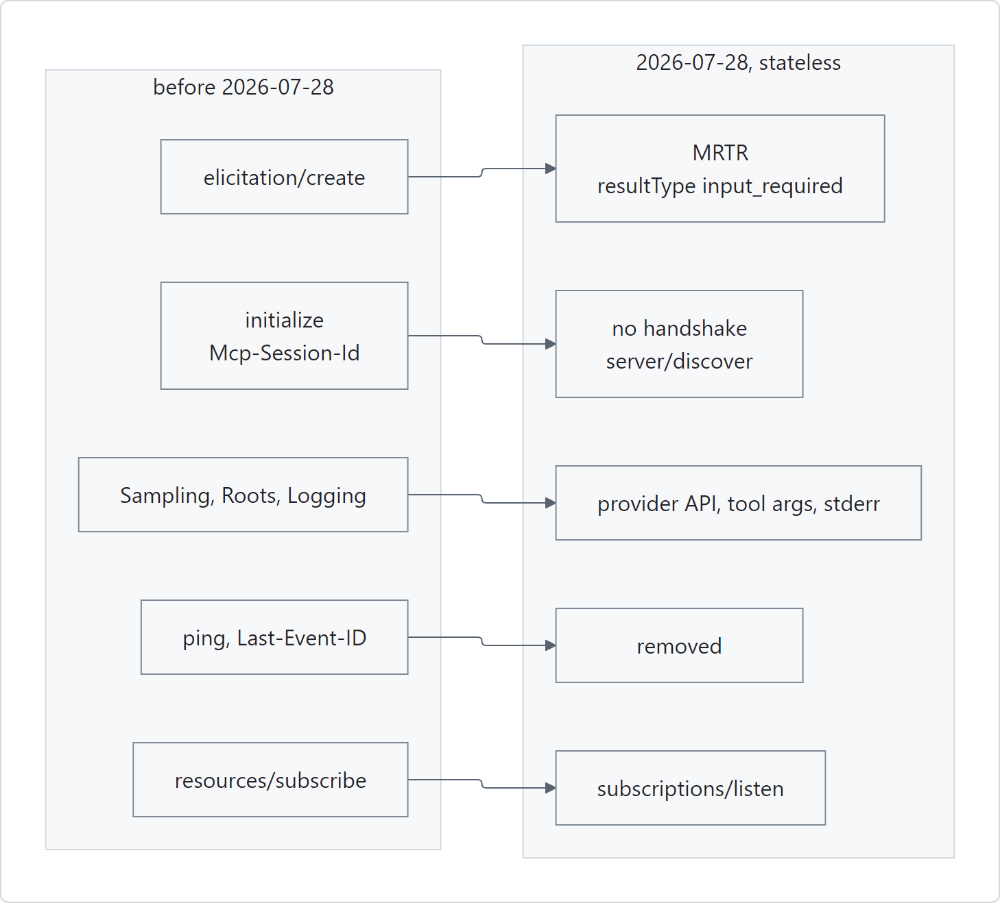
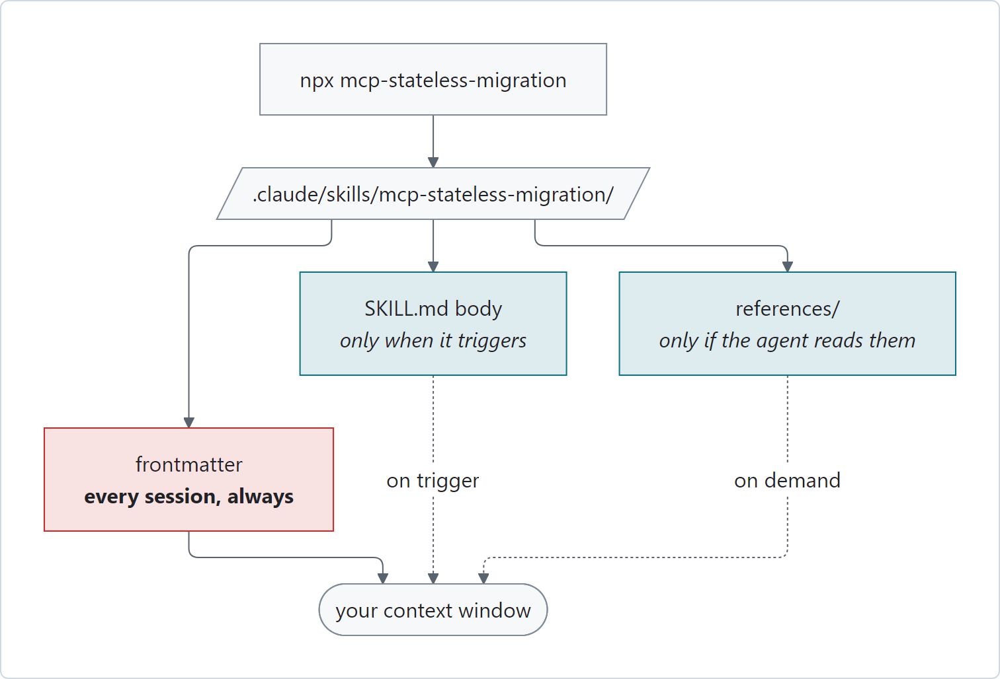
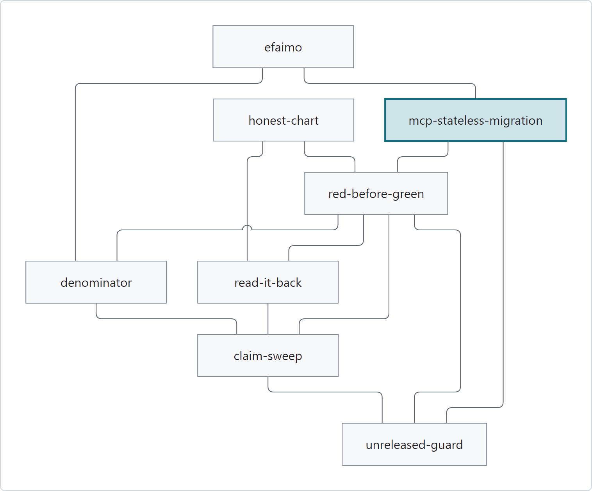

# mcp-stateless-migration

[](https://www.npmjs.com/package/mcp-stateless-migration)
[](LICENSE)
[-0b7285)](https://efaimo.com/skills)
[](https://github.com/efaimo-ai/mcp-stateless-migration/actions/workflows/house-style.yml)

An Agent Skill for migrating an MCP server to the stateless MCP specification
published on **2026-07-28**, and for keeping it open to the clients that still
speak 2025-11-25 while you do.

<!-- generated:install -->

## Install

```sh
# into ./.claude/skills/mcp-stateless-migration/
npx mcp-stateless-migration

# into ~/.claude/skills/mcp-stateless-migration/, for every project
npx mcp-stateless-migration --global

# installed already, and still current?
npx mcp-stateless-migration --check
```

The package is the skill: `SKILL.md` and its `references/`, nothing else. The
installer copies them, reads every byte back, and fails if what landed is not
what it wrote. It refuses to overwrite a directory whose contents differ unless
you pass `--force`, and installing the same version twice is a success rather
than a conflict.

Or take it by hand. It is markdown; `npx mcp-stateless-migration --print` writes `SKILL.md` to
stdout, and the repository is the whole thing.

<!-- /generated:install -->

## What moves

<picture>
  <source media="(prefers-color-scheme: dark)" srcset="https://raw.githubusercontent.com/efaimo-ai/mcp-stateless-migration/main/assets/diagram-603ad85d8b-dark.png">
  
</picture>

<details>
<summary>Mermaid source</summary>

```text
flowchart LR
    accDescr: What moves in the stateless revision of 2026-07-28. initialize and Mcp-Session-Id give way to no handshake and server/discover. Sampling, Roots and Logging move to the provider API, tool arguments and stderr. elicitation/create becomes MRTR with resultType input_required. ping and Last-Event-ID are removed. resources/subscribe becomes subscriptions/listen.
    subgraph OLD["before 2026-07-28"]
        A1["initialize<br/>Mcp-Session-Id"]
        A2["Sampling, Roots, Logging"]
        A3["elicitation/create"]
        A4["ping, Last-Event-ID"]
        A5["resources/subscribe"]
    end
    subgraph NEW["2026-07-28, stateless"]
        B1["no handshake<br/>server/discover"]
        B2["provider API, tool args, stderr"]
        B3["MRTR<br/>resultType input_required"]
        B4["removed"]
        B5["subscriptions/listen"]
    end
    A1 --> B1
    A2 --> B2
    A3 --> B3
    A4 --> B4
    A5 --> B5
```

</details>

Thirteen changes in total. Two of them have no readiness rule behind them and
have to be checked by hand; the skill says which two where an agent will read it.
A few more changes sit outside that count (the removed elicitation completion
notification, the deprecated HTTP+SSE transport) and are listed separately.

The first thing the skill asks is whether clients that open with `initialize`
still connect. Unless every client is known to speak 2026-07-28, it recommends
serving both revisions on one endpoint, which the spec allows: a server that
speaks only 2026-07-28 fails every older client, and those clients cannot fall
forward
([compatibility matrix](https://modelcontextprotocol.io/specification/2026-07-28/basic/versioning#compatibility-matrix)).

## Why a skill and not a blog post

The revision published on 2026-07-28, later than many model training cutoffs, so
a coding agent asked to "make this server 2026-07-28 ready" is working from the
old protocol or from guesses.

There is a second trap underneath that one. For the 68 days between the Release
Candidate locking on 2026-05-21 and the spec publishing, the RC was the only
thing there was to read, and it is not the published spec: server identity
moved into `_meta`, `DiscoverResult` became cacheable, and three error codes
were renumbered. You do not have to take that on trust, and you do not need a
survey of the internet to apply it. It is a one line test on any source you are
about to follow: if it names `DiscoverResult.serverInfo`, or error `-32003` or
`-32004`, it is reading the RC.

We know the trap is real because we fell into it. efaimo's own readiness rules
were written against the RC, and for four days after the spec published they
reported "identity unknown" for exactly the servers that had finished
migrating. The fix, and the diff that found it, are what this skill packages.

This skill carries the published shapes, the deltas from the RC, and the two
independent checks that prove the migration landed.

The protocol facts in it are verified against `schema/2026-07-28/schema.ts` at
tag `2026-07-28` in `modelcontextprotocol/modelcontextprotocol`, not against a
summary. `references/rc-vs-final.md` includes the commands to reproduce the
RC-to-final diff yourself. The SDK, client and conformance suite facts change
faster; they were checked on 2026-11-16 and carry that date in
`references/sdks.md`.

## What is in it

| file | loaded | contents |
|---|---|---|
| `SKILL.md` | on trigger | which clients to keep, then three steps: measure, change, prove |
| `references/changes.md` | on demand | all thirteen changes with their SEP or PR, what else changed, and the shapes to emit |
| `references/sdks.md` | on demand | per SDK entry points and versions, client behaviour, dated 2026-11-16 |
| `references/rc-vs-final.md` | on demand | what moved between the locked RC and the published spec |
| `references/verify.md` | on demand | how to prove it landed, and what a passing suite still misses |

## Its own numbers

Audited by [efaimo](https://github.com/efaimo-ai/efaimo), which is the same
tool this skill tells you to run:

```
$ npx efaimo@0.6.2 check --skill ./mcp-stateless-migration
efaimo v0.6.2
check skill  mcp-stateless-migration
grade A (100)   0 errors  0 warnings  0 info

  no findings. clean.

rules: https://github.com/efaimo-ai/efaimo/blob/main/docs/RULES.md

$ npx efaimo@0.6.2 weigh ./mcp-stateless-migration
efaimo v0.6.2
  skill                        metadata      body  lines  refs
  mcp-stateless-migration           186     3,020    212  4 files 6,167

totals: metadata 186 (always loaded) | body 3,020 (on trigger) | referenced 6,167 (on demand)

note: metadata loads at session start for every installed skill; body loads on trigger; referenced files load on demand
note: token counts are o200k_base estimates (see docs/METHODOLOGY.md)
```

Captured verbatim from `efaimo@0.6.2` on 2026-11-16. Two edits: the
`weigh skills` header line is removed, because it prints this machine's
absolute path, and the two command lines name the version that ran
(`efaimo@0.6.2`) so that they reproduce this output rather than whatever
`latest` is when you read this. (Until 2026-08-02 this section quoted a reference count of
3,305 from the commit before `references/changes.md` gained its thirteenth
change: the numbers had outlived the measurement by one commit, in the README
of a brand whose product exists to catch exactly that.)

186 tokens sit in your context at all times, which is what every installed
skill costs you whether or not you use it. The 3,020 token body loads only when
the skill triggers, and the 6,167 tokens of reference material only when it is
actually read. This is the text revised on 2026-11-16 (the dual-era step, the
SDK entry points, a fourth reference file) and published that day; the capture
that stood here before measured the 2026-09-04 text. Re-run both commands
yourself, which is the point of quoting them at all.

(The body number read 1,428 here until 2026-09-05, three lines under a table
that said 1,517 and one paragraph under the note about this exact thing having
happened before. The table was watched and the sentence was not, so the check
that reads these READMEs now reads both.)

## Scope

This skill tells you what to change and how to prove it landed. It does not
migrate the code for you, and a clean `efaimo` readiness list is not the same as
all thirteen changes done: two of them (the `Mcp-Method` / `Mcp-Name` headers, and
Tasks moving to an extension) have no readiness rule behind them and need
checking by hand. `SKILL.md` says so where an agent will read it.

<!-- generated:pipeline -->

## What installing it does to a session

A skill is not free just because it is markdown. Its frontmatter is loaded at
the start of every session for every skill you have installed, whether or not it
ever fires.

<picture>
  <source media="(prefers-color-scheme: dark)" srcset="https://raw.githubusercontent.com/efaimo-ai/mcp-stateless-migration/main/assets/diagram-ac90419809-dark.png">
  
</picture>

<details>
<summary>Mermaid source</summary>

```text
flowchart TD
    accDescr: Installing puts SKILL.md and references/ in .claude/skills/mcp-stateless-migration/. The frontmatter enters your context window in every session, the body only when the skill triggers, and the references only if the agent reads them.
    N["npx mcp-stateless-migration"] --> D[/".claude/skills/mcp-stateless-migration/"/]
    D --> M["frontmatter<br/><b>every session, always</b>"]
    D --> B["SKILL.md body<br/><i>only when it triggers</i>"]
    D --> R["references/<br/><i>only if the agent reads them</i>"]
    M --> S(["your context window"])
    B -.->|"on trigger"| S
    R -.->|"on demand"| S
    classDef always fill:#c9282822,stroke:#c92828,stroke-width:1px;
    classDef lazy fill:#0b728522,stroke:#0b7285,stroke-width:1px;
    class M always;
    class B,R lazy;
```

</details>

In this skill's case, measured by [efaimo](https://github.com/efaimo-ai/efaimo) `weigh` (v0.6.2, 2026-11-16):
**186 tokens always resident**, 3,020 when it triggers, 6,167 across 4 reference files if the agent reads to the end.

<!-- /generated:pipeline -->

<!-- generated:set -->

## The set

Every skill in this set is about a report that was true about the wrong thing.

| skill | something reported | what the report was really about |
|---|---|---|
| [`red-before-green`](https://github.com/efaimo-ai/red-before-green) | a check said clean | whether it ran at all |
| [`denominator`](https://github.com/efaimo-ai/denominator) | a check said clean | how much of the world it saw |
| [`read-it-back`](https://github.com/efaimo-ai/read-it-back) | a write said done | whether it applied |
| [`claim-sweep`](https://github.com/efaimo-ai/claim-sweep) | a change said done | everything else still asserting the old value |
| [`unreleased-guard`](https://github.com/efaimo-ai/unreleased-guard) | a document said true | which version it is true of |
| [`honest-chart`](https://github.com/efaimo-ai/honest-chart) | a picture said the data | whether its geometry is proportional |
| **`mcp-stateless-migration`** | a server said ok | which revision it speaks |
| [`efaimo`](https://github.com/efaimo-ai/efaimo) | a tool said A(100) | what a grade certifies, and what it costs |

<picture>
  <source media="(prefers-color-scheme: dark)" srcset="https://raw.githubusercontent.com/efaimo-ai/mcp-stateless-migration/main/assets/diagram-6a4d757ce8-dark.png">
  
</picture>

<details>
<summary>Mermaid source</summary>

```text
graph TD
    accDescr: Every skill in the set and the efaimo CLI, with an edge for each handoff between two of them. mcp-stateless-migration is highlighted.
    red_before_green["red-before-green"]
    denominator["denominator"]
    read_it_back["read-it-back"]
    claim_sweep["claim-sweep"]
    unreleased_guard["unreleased-guard"]
    honest_chart["honest-chart"]
    mcp_stateless_migration["mcp-stateless-migration"]
    efaimo["efaimo"]
    red_before_green --- denominator
    red_before_green --- read_it_back
    denominator --- claim_sweep
    read_it_back --- claim_sweep
    claim_sweep --- red_before_green
    claim_sweep --- unreleased_guard
    unreleased_guard --- red_before_green
    honest_chart --- red_before_green
    honest_chart --- read_it_back
    mcp_stateless_migration --- unreleased_guard
    mcp_stateless_migration --- red_before_green
    efaimo --- denominator
    efaimo --- mcp_stateless_migration
    classDef self fill:#0b728533,stroke:#0b7285,stroke-width:2px;
    class mcp_stateless_migration self;
```

</details>

Each edge is a real handoff, not a category: the reason one skill points at
another is written into it at [efaimo.com/skills](https://efaimo.com/skills), and
in the `Siblings` section of every `SKILL.md`. All of them are graded and
weighed by [`efaimo`](https://github.com/efaimo-ai/efaimo), the CLI that measures
what an agent loads.

<!-- /generated:set -->

## License

Apache-2.0. See [`LICENSE`](LICENSE) and [`NOTICE`](NOTICE).
